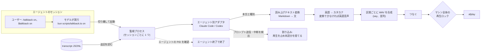

# talkback

状態: **MVP**。Claude Code（デスクトップアプリと CLI）で動作を確認した。Codex は、テスト用の偽の環境でしか確認していない。

`talkback` は、コーディングエージェントの返答を音声で読み上げるスキルである。読み上げはセッションごとに、スキル経由で ON/OFF する。ON の間は、バックグラウンドの監視プロセスがセッションの transcript を追い、assistant のメッセージを macOS の `say` で読み上げる。コードブロックと表は読み上げず、代わりに種類と量を読む。英単語や識別子はカタカナに変換し、日本語の音声でも聞き取れるようにする。

対象は Claude Code と Codex で、macOS と Bun が必要になる。

## 目的

- 読み上げの ON/OFF を、セッションの中から、そのセッションだけを対象に切り替えられる。
- turn の終わりを待たず、エージェントの作業中から読み上げる。
- 日本語と英語が混ざった文を聞き取れる形で読む。コード、表、URL、長い識別子は要約するか読み飛ばし、英単語はカタカナで読む。
- スキルだけで配布する。hook も設定の変更も使わず、OFF の間は何も常駐させない。

## MVP の対象外

| 項目 | 対象外とする理由 |
| --- | --- |
| カタカナの読みを登録するユーザー辞書 | あれば便利だが、同梱する辞書と英語音声へのフォールバックで MVP の用途は足りる |
| メッセージの生成中に行単位で読む機能（Claude Code の `MessageDisplay` hook） | 入力元が 2 系統になり、書きかけのブロックの扱いも要る。MVP はメッセージ単位で十分である |
| 長い返答の打ち切りや要約 | 返答は全文を読む。読み上げは、新しいプロンプトの送信、turn の中断、`off` で止まる |
| 読み上げを ON にしたまま、今の発話だけを止める操作 | 現時点では要らない |
| ツールの実行許可を待っていることの通知 | 許可を求める画面は transcript に出ない。時間からの推測では長いコマンドの実行中に誤って知らせてしまい、正確に検出するには hook が要る |
| `say` 以外の音声合成エンジン | 英語をカタカナに直せば、ローカルで無料の `say` で足りる。後から VOICEVOX などを足せるように、処理の層だけは分けておく（[拡張性](#拡張性) を参照） |
| Linux と Windows | `say` と `afplay` は macOS にしかない |

## 決定事項

| 論点 | 決定 |
| --- | --- |
| 入力元 | 両エージェントとも、セッションの transcript（JSONL）を監視する。hook は使わない |
| 粒度 | assistant のメッセージ単位。ツール呼び出しの合間に出るテキストブロックと、最終応答が対象になる |
| 中間メッセージ | 最初の 1 文だけ読む |
| 最終応答 | 全文を読む |
| 質問で終わる turn | 質問（Claude Code の `AskUserQuestion` など）の直前の説明文を最終応答として全文読み、続けて質問文を読む。選択肢は読まない |
| ON/OFF の操作 | ユーザーがスキルを呼ぶと、モデルが `talkback.ts on` / `off` を実行する。プロンプトを横取りする hook は使わない |
| 監視プロセスの寿命 | `on` で起動し、`off` で止める。エージェントのプロセスが終了したら、自分も終了する |
| 割り込み | ユーザーがそのセッションで新しいプロンプトを送るか、turn を中断（Esc）したら、今の発話を止め、そのセッションの未読分を捨てる |
| 複数セッションが ON | マシン全体で 1 つの再生ロックを取り合い、発話を重ねない。セッション間の順番は保証しない |
| セッションの切り替わり | 直前と別のセッションの発話を始めるときは、先にプロジェクト名（cwd のディレクトリ名）を読む |
| コードブロックと表 | 種類と量に置き換える（例:「TypeScript のコード 12 行」「3 行の表」） |
| インラインコード | パスならファイル名だけを読む。パス以外は、20 文字以下なら中身を読み、それより長ければ「コード」に置き換える |
| 英語 | 同梱の辞書で単語をカタカナに変換する。変換しきれない語のまとまりと、空白でつながった英文は、英語の音声（Samantha）で読む |
| 辞書 | 自前の上書き表を先に引き、次に VOICEVOX の kanalizer-dataset（MIT）を引く |
| 再生 | 区間ごとの WAV を並列に合成し、つないでから再生する。声の切り替えで間が空かない |
| sandbox | `talkback` は sandbox の外で実行する。`on` が sandbox の中にいることを検出したら、終了コード 2 で終わり、設定の直し方を出力する |
| 言語と実行環境 | Bun 上の TypeScript。Markdown は組み込みの `Bun.markdown` で解析する。npm の依存パッケージは使わない |

## 構成



### ファイル

```text
skills/talkback/
├── SKILL.md            # モデルに、いつ・どう CLI を実行するかを伝える（英語）
├── README.md           # この仕様書
├── agents/openai.yaml  # Codex 向けの表示用メタデータ
├── scripts/
│   ├── talkback.ts         # CLI: on | off | status | doctor
│   ├── watcher.ts          # セッションごとの監視プロセス
│   ├── dev/build-dict.ts   # kanalizer-dataset を TSV に変換する（開発者用）
│   └── lib/
│       ├── adapters/       # Claude Code と Codex の transcript をイベントに変換する
│       ├── text.ts         # 1 層目: Markdown → 読み上げ用の文
│       ├── reading.ts      # 2 層目: 英語の読みを決め、声の役割ごとの区間に分ける
│       ├── audio.ts        # 3 層目: 合成、WAV の連結、再生
│       ├── lock.ts         # マシン全体の再生ロック
│       └── agent.ts, proc.ts, state.ts, paths.ts
├── tests/                  # bun test。say と afplay は PATH の先頭に置いた偽物で置き換える
└── assets/
    └── katakana/
        ├── overrides.tsv         # 自前の上書き表（MIT）
        ├── kanalizer.tsv         # kanalizer-dataset を変換したもの
        └── kanalizer.LICENSE     # kanalizer-dataset のライセンスと出典
```

`SKILL.md` は、リポジトリの既存のスキルに合わせて英語で書く。`agents/openai.yaml` の `short_description` と `default_prompt` は日本語で書く。

実行時の状態は `~/.local/state/talkback/`（パーミッション 0700）に置く。

```text
~/.local/state/talkback/
├── sessions/<session-id>.json  # 監視プロセスとエージェントの PID・起動時刻、エージェントの種類、transcript のパス、cwd
├── play.lock                   # マシン全体の再生ロック
├── waiting/<session-id>        # ロックを待っているセッションの目印
├── last-speaker                # 最後に発話したセッションの ID
└── logs/<session-id>.log       # 本文を含まないログ（上限 1 MB）
```

合成した WAV は `$TMPDIR/talkback-<session-id>-XXXXXX/`（`mkdtemp` で作るので 0700）に置き、再生が終わったら消す。監視プロセスの終了時にディレクトリごと消す。

## コンポーネント

### スキル（`SKILL.md`）

スキルはモデルに、コマンドを 1 つ実行し、結果を 1 行で報告するよう指示する。内部の仕組みは書かない。

| ユーザーの意図 | コマンド |
| --- | --- |
| ON にする | `bun <skill-dir>/scripts/talkback.ts on` |
| OFF にする | `bun <skill-dir>/scripts/talkback.ts off` |
| 状態を確認する | `bun <skill-dir>/scripts/talkback.ts status` |
| 動かない原因を調べる | `bun <skill-dir>/scripts/talkback.ts doctor` |

- Claude Code は、スキル本文の `${CLAUDE_SKILL_DIR}` を展開する。Codex はモデルに `SKILL.md` のパスを示すので、スキル本文には「`scripts/` は `SKILL.md` と同じディレクトリにある」とも書く。
- Claude Code では、frontmatter の `allowed-tools` に `Bash(bun ${CLAUDE_SKILL_DIR}/scripts/talkback.ts:*)` を書く。これで、ON/OFF のたびに許可を求められなくなる。
- Codex では、コマンドを `bash -lc` などで包まず、そのまま実行するようモデルに指示する。実行ルールに一致させるためである。
- `on` が終了コード 2 で終わったら、モデルは出力された直し方をユーザーに伝える。設定ファイルを自分で書き換えてはいけない。Codex で 1 回限りの権限昇格で続けるかどうかは、ユーザーに選ばせる。詳細は [sandbox](#sandbox) に書く。
- `agents/openai.yaml` には `policy.allow_implicit_invocation: false` を設定する。明示的に頼まれない限り、モデルが読み上げを ON にしないためである。

### CLI（`talkback.ts`）

CLI は環境変数からエージェントを判定する。引数は要らない。判定は上の行から順に行う。

| エージェント | 判定に使う変数 | セッション ID | エージェントの PID |
| --- | --- | --- | --- |
| Codex | `CODEX_THREAD_ID` がある | `CODEX_THREAD_ID` | 祖先プロセスのうち、名前が `codex` の最も近いもの |
| Claude Code | `CLAUDECODE=1` | `CLAUDE_CODE_SESSION_ID` | `CLAUDE_PID` |

Codex を先に判定するのは、Claude Code から Codex を起動した場合（codex プラグイン経由など）に、Codex のシェルにも Claude Code の環境変数が引き継がれるからである。手元の rollout には、`originator: "Claude Code"` のものが 20 件以上あった。

PID は、取り違えを防ぐため、常に起動時刻（`ps -o lstart=`）と組にして扱う。以下で「PID が生きている」とは、その PID のプロセスがあり、起動時刻も記録と一致することを指す。

サブコマンド:

- `on`:
  1. [sandbox の確認](#sandbox-の確認) を行う。
  2. エージェントの PID を特定する。特定できなければ、終了コード 2 で終わる。監視プロセスが終了できずに残り続けるのを防ぐためである。
  3. transcript を `<セッション ID>.jsonl` の完全一致で探し、その時点のファイル末尾の位置を記録する。
  4. 同じセッションの監視プロセスが生きていれば、ON 済みである旨を出力して終了コード 0 で終わる。Claude Code では、同じエージェントの PID を持つ別のセッションの監視プロセスが生きていれば、`/clear` などでセッションが切り替わったとみなして止める。Codex では止めない。1 つのアプリのプロセスが、複数のスレッドを同時に扱うことがあるからである。
  5. 監視プロセスを切り離して起動する（`Bun.spawn` に `detached: true` を指定し、標準入出力をログファイルにつないでから `unref()` する）。切り離したプロセスは、自分のプロセスグループの先頭になる。
  6. 状態ファイルを書き、1 行出力する。cwd は transcript の先頭の行（セッションを始めた場所）から取って固定する。最新の行の cwd は、作業中の `cd` に合わせてサブディレクトリに変わるからである。
- `off`: 最初に [sandbox の確認](#sandbox-の確認) を行う。sandbox の中ではすべてのプロセスが止まっているように見え、動いている監視プロセスの状態ファイルを消してしまうからである。次に、状態ファイルの監視プロセスが生きていて（PID と起動時刻が一致し）、コマンドラインに `watcher.ts` が含まれる場合に限り、そのプロセスグループに `SIGTERM` を送る。セッション ID は照合しない。resume のあとも、監視プロセスのコマンドラインには起動時のセッション ID が残るからである。プロセスグループごと送るので、合成中の `say` と再生中の `afplay` も止まる。監視プロセスがいなければ、残った状態ファイルを消して終了コード 0 で終わる。
- `status`: 今のセッションの ON/OFF と、ON になっているセッションの数を出力する。数えるのは、監視プロセスが生きているものだけである。
- `doctor`: 前提条件を確認し、直すべき点を出力する。確認するのは次の項目である。
  - `say`、`afplay`、Kyoko と Samantha の音声
  - Bun のバージョン（`Bun.markdown` があること）
  - 環境変数（`CLAUDE_CODE_SESSION_ID`、`CLAUDE_PID`、`CODEX_THREAD_ID`）と transcript が見つかること、transcript の最新の行を解析できること
  - [sandbox の確認](#sandbox-の確認) の結果。Codex では、必要な実行ルールも出力する

終了コード: 0 は成功、1 は実行時エラー、2 は前提条件の不足（直し方を出力する）。

### 監視プロセス（`watcher.ts`）

- `on` が記録した位置から transcript を読む。履歴は読まない。記録した位置が行の途中だったら、次の改行までを読み飛ばす。`on` を頼んだときの返答は読み上げるので、読み上げが動いていることをその場で確認できる。
- 追記された行を `fs.watch` で追い、250 ms ごとのポーリングで取りこぼしを補う。末尾の行が書きかけなら、改行が届くまで保持する。
- Claude Code の transcript に `continued-in`（`continuedInSessionId`）の行が現れたら、同じディレクトリの移り先のファイルに切り替える。
  - 移り先のファイルは、`continued-in` の行より数秒遅れて作られる（手元の 3 件で 3〜4 秒）。そのため、現れるまでポーリングで待つ。60 秒待っても現れなければ終了する。
  - 移り先のファイルの先頭には、それまでの履歴が新しいセッション ID でコピーされている。そのため、移り先はファイルの末尾から読む。
  - 状態ファイルは新しいセッション ID の名前に移す。移り先のセッションで実行した `off` と `status` が、新しい ID で状態ファイルを探すからである。
- エージェントの PID が生きているかを 2 秒ごとに確認し、いなくなったら終了する。
- 終了するとき（エージェントの終了、`SIGTERM` のどちらでも）は、合成と再生の子プロセスを止め、未読分を捨て、ロックを持っていれば解放し、待ちの目印、一時 WAV、状態ファイルを消す。
- 起動時に、プロジェクト名を読み上げる WAV を先に合成しておく。ロックを取ってから合成すると、発話が遅れるからである。
- エラーは自分のログファイルに書く。エージェントの画面には何も出さない。ログには行の種類、キー、長さだけを書き、本文は書かない。transcript にはツールの出力や秘密の値が含まれうるからである。ログが 1 MB を超えたら、動作中でも空にする。

### エージェント別アダプタ

アダプタは transcript の行をイベントに変換する。イベントは `message(text, kind)`、`question(texts)`、`interrupt` の 3 種類で、`kind` は `intermediate`（中間）か `final`（最終）である。

**Claude Code** の transcript は `~/.claude/projects/<project-slug>/<session-id>.jsonl` にある。content block ごとに 1 行ずつ書かれる。同じメッセージの行には、どれも同じ `message.stop_reason` が入っている。

| 行 | イベント |
| --- | --- |
| `type: "assistant"`、content block が `text`、`message.stop_reason: "tool_use"` | `message(…, intermediate)`（下の保留を参照） |
| `type: "assistant"`、content block が `text`、`message.stop_reason` が `tool_use` 以外（`end_turn`、`stop_sequence`、`null`、未知の値など） | `message(…, final)` |
| `type: "assistant"`、content block が `tool_use` で `name: "AskUserQuestion"` | `question(input.questions[].question)` |
| `type: "user"` で、ユーザーが入力したプロンプト（判定は下を参照） | `interrupt` |
| `type: "user"` で、本文が `[Request interrupted by user` で始まる | `interrupt` |
| `type: "attachment"`、`attachment.type: "queued_command"`、`attachment.origin.kind: "human"`（作業中に入力して待たせているプロンプト） | `interrupt` |
| `isSidechain: true` の行 | 無視する |

ユーザーが入力したプロンプトの判定:

- `type: "user"` の行には、ユーザーの入力以外も含まれる。手元の transcript では、subagent やタスクの完了通知（`<task-notification>`）、スラッシュコマンドの展開（`<command-name>`）、`<system-reminder>`、`!` コマンドの入出力（`<bash-input>`、`<bash-stdout>`）、`tool_result` を確認した。これらで割り込むと、バックグラウンドの作業が終わるたびに読み上げが止まる。
- `origin.kind` があれば、`"human"` の行だけをプロンプトとする。
- `origin.kind` がなく `promptSource` があれば、`typed`、`queued`、`suggestion_accepted`、`sdk` の行だけをプロンプトとする。
- どちらのキーもない古い形式の行は、`isMeta` が真でなく、本文が文字列で、`<` で始まらないものをプロンプトとする。

`stop_reason: "tool_use"` の `text` の行は、すぐには `intermediate` にしない。同じ `message.id` の次の行が届くまで保留する。

- 次の行が `AskUserQuestion` の `tool_use` なら、保留していた文を `message(…, final)` として出し、続けて `question` を出す。
- 次の行がそれ以外の `tool_use` なら、`message(…, intermediate)` として出す。
- 1 秒待っても次の行が届かなければ、`message(…, intermediate)` として出す。

`text` の行と `tool_use` の行は続けて書かれることを手元の transcript で確認しているので、保留による遅れは小さいと見込む。

subagent の出力は、本体とは別のファイル（`<session-id>/subagents/`）に書かれる。手元の本体のファイルには `isSidechain: true` の行はなかったが、古い形式に備えて無視する規則は残す。

**Codex** の transcript は `~/.codex/sessions/YYYY/MM/DD/rollout-*-<thread-id>.jsonl` にある。

| 行 | イベント |
| --- | --- |
| `type: "event_msg"`、`payload.type: "agent_message"`、`payload.phase: "commentary"` | `message(…, intermediate)` |
| `type: "event_msg"`、`payload.type: "agent_message"`、`payload.phase: "final_answer"` | `message(…, final)` |
| `type: "event_msg"`、`payload.type: "agent_message"`、`payload.phase` がない | 保留する（下を参照） |
| `type: "event_msg"`、`payload.type: "user_message"` で、本文が `<` で始まらない | `interrupt` |
| `type: "event_msg"`、`payload.type: "turn_aborted"` | `interrupt` |

`phase` のない `agent_message` は保留する。`task_complete` が届けば `final`、次の `agent_message` かツール呼び出しが届けば `intermediate` として出す。それ以外のイベント（`token_count` など）では判定しない。最終応答と `task_complete` の間には、`token_count` が入ることがあるからである。時間切れでの判定もしない。手元の rollout では、Codex のデスクトップアプリ（`Codex Desktop 0.128.0-alpha.1`）が `phase` を書いていなかった。CLI（codex-tui 0.128.0〜0.133.0）では、`final_answer` の直後に必ず `task_complete` が続いていた。

`user_message` のうち `<` で始まるもの（`<task-notification>`、`<command-name>` など）は、ユーザーの入力ではないので無視する。

`response_item` の行には同じメッセージが重複して入るので、無視する。手元では、`response_item` と `event_msg` の件数が一致しないファイルもあった。`event_msg` だけを使う方針で、取りこぼしが出うることは許容する。

Codex でユーザーに入力を求めるツール（`request_user_input` など）が transcript にどう書かれるかは、まだ確認していない。確認するまで、Codex のアダプタは `question` を出さない。

subagent のスレッドは別の rollout（`source: subagent`）に書かれるので、親のファイルの監視には混ざらない。

どちらの transcript も形式は公開されていない。アダプタは未知の種類の行を無視し、解析できない行はログに書いて読み飛ばす。形式が変わったときに、監視プロセスが異常終了するのではなく、読み上げが止まるだけで済ませるためである。

### 読み上げテキスト変換

入力は Markdown のメッセージ 1 件で、出力は読み上げ用のプレーンテキストである。声の役割ごとの区間に分けるのは、次の [英語 → カタカナ](#英語--カタカナ) である。

1. `Bun.markdown.render(text, callbacks, { tables: true, autolinks: true })` で解析する。監視プロセスに届く時点でメッセージは完結しているので、逐次型のパーサーは要らない。
2. ノードを次のように読む。

   | ノード | 読み方 |
   | --- | --- |
   | 見出し | テキストの後に「。」を付ける |
   | 段落、リスト項目、引用、強調 | テキストをそのまま読む |
   | コードブロック（フェンス、インデント） | 「<言語> のコード N 行」。言語の指定がなければ「コード N 行」 |
   | 表 | 「N 行の表」（ヘッダーを除いた行数） |
   | インラインコード | パスならファイル名だけを読む（長さは問わない）。パス以外は、20 文字以下なら中身を読み、それより長ければ「コード」 |
   | リンク | リンク文字列だけを読む。URL がそのままリンク文字列になっている autolink は「リンク」 |
   | 画像 | 代替テキストを読む。なければ何も読まない |
   | HTML | 何も読まない。段落の中のタグ（`<br>` など）も取り除く |

3. テキストを後処理する。
   - パーサーがリンクにしなかった URL（リスト項目の中で観測した）は「リンク」に置き換える。
   - 地の文のパスも、ファイル名だけにする（`src/components/Button.tsx` → `Button.tsx`）。
   - 絵文字を消す。
   - `[[` と `]]` を消す。`say` は `[[volm 0]]` のような文字列を、音量や速度を変える埋め込みコマンドとして解釈するからである。標準入力で渡しても、この解釈は防げない（実機で確認した）。絵文字を先に消すのは、`[🎉[` のように絵文字を挟んだ `[[` を残さないためである。
4. 中間メッセージは、最初の段落の最初の 1 文だけを残す。段落がなく、コードブロックや表から始まる場合は、最初の置き換え文言（「TypeScript のコード 12 行」など）を読む。文の区切りは「。」「！」「？」「!」「?」と改行である。
5. `question` は、質問が 1 つなら「質問です。」、複数なら「質問が N つあります。」と読んでから、各質問文を順に読む。質問文も 1〜3 と同じ変換にかける。選択肢は読まない。
6. [英語 → カタカナ](#英語--カタカナ) に渡す。

パスとみなすのは、`/` を含む空白のない文字列のうち、次のどちらかに当たるものである。`ON/OFF`、`TODO/FIXME`、`2026/10/23` のような語を、パスとして縮めないためである。

- `/`、`./`、`../`、`~/` で始まる
- 最後の `/` より後ろが、拡張子の付いた名前（`.` と英字で始まる拡張子で終わる）である

URL は ASCII の文字だけを URL とみなす。`https://e.com/aを参照` のように、URL の直後に空白なしで続く日本語を消さないためである。

### 英語 → カタカナ

Kyoko は英語を聞き取りにくく読むが、カタカナなら明瞭に読める。出力は区間 `{ voice: "ja" | "en", text }` の列である。

最初に、英文を探す。ASCII の単語が空白で 3 つ以上つながった並び（例: `Use the default config`）は、英文とみなし、まとめて 1 つの `en` の区間にする。英文の途中で声が入れ替わらないようにするためである。2 語以下の並びは、次の単語単位の変換にかける。

英文以外は、ASCII の英字・数字・`._/-` が連続するまとまり単位で変換する。

1. まとまりを単語に分ける。
   - 区切りは `.`、`/`、`_`、`-`、camelCase の境目、英字と数字の境目である。
   - camelCase では、大文字の連続の最後の 1 文字を次の単語の頭にする（`XMLHttpRequest` → `XML`、`Http`、`Request`）。
   - 数字と数字の間の `.` と `-` は区切らずに残す（`python3.12` →「パイソン3.12」、`1.2.3-beta` →「1.2.3 ベータ」）。数字の部分は Kyoko にそのまま渡す。
   - 2〜5 文字の大文字に `s` が付いた語（`PRs`、`APIs`）は、複数形の頭字語として「ピーアールズ」のように読む。
   - 区切った結果の空の語（`--flag` の先頭など）は捨てる。
2. 単語ごとに、次の順で読みを決める。最初に決まったものを使う。
   1. 上書き表にある語（大文字小文字を区別しない）は、上書き表のカタカナにする。
   2. 1 文字の語と、2〜3 文字の大文字だけの語（`PR`、`CLI`）は、アルファベットのカタカナ読みにする（ピーアール）。
   3. まとまりの最後の `.` より後ろの語で、拡張子の一覧（`reading.ts` の `EXTENSIONS`）にあるものは、アルファベット読みにする（`tsx` → ティーエスエックス）。一覧にない語は、拡張子として扱わない（`React.memo` の `memo` は通常の語として引く）。
   4. 数字はそのまま残す。Kyoko は数字を正しく読む。バージョン（`v1.3.11`）は「ブイ1.3.11」と読む。
   5. kanalizer-dataset にある語は、その最初の読みにする。
   6. 4〜5 文字の大文字だけの語は、kanalizer-dataset になければアルファベット読みにする（`UUID` は上書き表、`HEAD` は辞書の「ヘッド」）。
3. すべての単語の読みが決まれば、まとまりをカタカナをつないだものに置き換える。1 語でも決まらなければ、まとまり全体を Samantha が読む `en` の区間にする。まとまりの途中では声を切り替えないので、1 つの識別子から生まれる `en` の区間は最大 1 つになる。

4〜5 文字の大文字の語を辞書の後に回すのは、`HEAD` や `TODO` を単語として読ませるためである。kanalizer-dataset は小文字にした頭字語の読みを誤ることがある（`id` →「イド」、`http` →「ハットップ」）。このような語は上書き表で直す。

既知の弱点として、ローマ字の識別子（`hoikuen`）は Samantha が英語として読むため、正しく読めない。

#### 辞書

| 辞書 | 内容 | ライセンス |
| --- | --- | --- |
| 上書き表（`overrides.tsv`） | kanalizer-dataset にないプログラミング用語（`json`、`readme`、`async`、`typescript`、`uuid` など）、kanalizer-dataset の誤りの修正（`button` → ボタン、`id` → アイディー、`todo` → トゥードゥー など） | MIT（このリポジトリ） |
| kanalizer-dataset（`kanalizer.tsv`） | VOICEVOX が公開している約 11.8 万語の英語→カタカナ辞書。単語リストは CMUdict などから取り、読みは LLM で生成している | MIT。出典とライセンス文を `kanalizer.LICENSE` に同梱する |

- 上書き表は、MVP では開発者が手で保守する。利用者が語を足すユーザー辞書は MVP の対象外である。
- kanalizer-dataset の JSONL は、`scripts/dev/build-dict.ts` で `word<TAB>kata` の TSV に変換して同梱する。監視プロセスの起動時に `Map` に読み込む。ファイルの大きさと読み込み時間は、実装時に測る。
- 取り込んだ版を追えるように、`kanalizer.LICENSE` には取得元の URL、Hugging Face の revision（コミットハッシュ）、取得日を書く。辞書の更新は、変換スクリプトを再実行して手作業で行う。
- git submodule は採用しない。本体の JSONL が Git LFS で管理されていて git-lfs が必要になるうえ、`--recurse-submodules` なしの clone や `npx skills add` では辞書が欠けるおそれがあるからである。
- 採用しなかった候補:
  - BEP 辞書: GPL のため同梱できない。表記も「イフェクト」「パッケイジ」のように発音記号寄りである。
  - JMdict: CC BY-SA 4.0 の義務が生じ、英語由来の語を抜き出す変換処理も要る。
  - 推論モデル（e2k、kanalizer モデル）: JavaScript で動く配布物がない。

出典: [VOICEVOX/kanalizer-dataset](https://huggingface.co/datasets/VOICEVOX/kanalizer-dataset)

### 合成と再生

1 件のメッセージを、3 文または 300 文字ごとのかたまりに分けて処理する。短いメッセージは 1 つのかたまりになる。

1. かたまりの区間ごとに、並列で合成する: `say -v <Kyoko|Samantha> [-r <rate>] -f - -o <tmp>.wav --file-format=WAVE --data-format=LEI16@22050`
   - テキストは標準入力で渡し、コマンド引数では渡さない。引数で渡すと、`-` で始まるテキストがオプションとして解釈されるからである（`--dry-run …` で失敗を観測した）。
   - `say` と `afplay` は、シェルを介さず、引数の配列で起動する。
2. 区間の PCM データをつないで、かたまりごとに 1 本の WAV にする。WAV のヘッダーは固定長と仮定せず、`data` チャンクを探して中身を取り出す。Apple の WAV には、`FLLR` などの余分なチャンクが入ることがあるからである。区間をつないだところで間が空かないことは確認済みである。
3. 再生ロックを取り、かたまりを順に `afplay` で再生する。次のかたまりは、今のかたまりを再生している間に合成する。かたまりの境目では `afplay` を起動し直すので、わずかな間が空くことがある。
4. メッセージの最後のかたまりを再生し終えたら、ロックを解放する。

ロック:

- ロックはメッセージ 1 件の間ずっと保持する。2 つのセッションの文が交互に混ざらないようにするためである。
- ロックは、`open(2)` の `O_EXLOCK | O_NONBLOCK` で `play.lock` を開いて取る。保持しているプロセスが異常終了しても、カーネルがロックを解放するからである。PID の照合や、古いロックの取り直しは要らない。
- 待っている側は 100 ms ごとにロックを試す。待っている間は `waiting/<session-id>` を置く。
- ロックを解放したセッションは、他のセッションの `waiting/` があれば、次のメッセージでロックを取り直す前に 300 ms 待つ。メッセージが続くセッションがロックを取り続けて、他のセッションが読み上げられなくなるのを防ぐためである。
- セッション間の順番は保証しない。セッション内の順番は守られる。

セッションの切り替わり:

- ロックを取ったら `last-speaker` を見る。中身が自分と異なるか、ファイルがなければ、先にプロジェクト名を読み、`last-speaker` を自分の ID に書き換える。
- プロジェクト名は cwd のディレクトリ名である。ON になっている他のセッションに同じディレクトリ名があれば、親ディレクトリの名前を前に付ける。

割り込み: `interrupt` を受けたら、監視プロセスは合成中の `say` と再生中の `afplay` を止め、未読のメッセージを捨て、ロックを持っていれば解放する。プロジェクト名の再生中に割り込まれた場合は `last-speaker` を書き換えず、次の発話で名前を読み直す。ロックを待っている途中なら、待つのをやめる。割り込みが効くのは、ユーザーの入力や中断が transcript に書かれた時点である。キーを押した時点ではない。

設定（MVP）: 監視プロセスの起動時に、次の環境変数を読む。

| 変数 | 既定値 | 説明 |
| --- | --- | --- |
| `TALKBACK_VOICE_JA` | `Kyoko` | 日本語の声 |
| `TALKBACK_VOICE_EN` | `Samantha` | 英語の声 |
| `TALKBACK_RATE` | なし | 読み上げ速度（1 分あたりの語数）。指定がなければ `-r` を付けず、声ごとの標準速度で読む。正の数でなければ無視する |

### sandbox

#### sandbox の確認

`on` は、sandbox の中で実行されていないかを最初に確認する。確認するのは、次の 2 点である。

1. `~/.local/state/talkback/` に書き込めるか。
2. エージェントの PID を特定でき、生存を確認できるか（Codex では `ps` で祖先プロセスをたどれるか）。

どちらかが失敗したら sandbox の中にいるとみなし、終了コード 2 で終わる。出力する直し方は、エージェントによって異なる。

- Claude Code: Claude Code の Bash の sandbox が有効になっている可能性がある。`talkback.ts` を sandbox の対象から外す設定（`sandbox.excludedCommands` など）を案内する。Claude Code の sandbox の中で、この確認が実際にどう失敗するかは検証していない。
- Codex: 下の [`on` の事前確認（Codex）](#on-の事前確認codex) に従う。

2 点目も確認するのは、`writable_roots` に `~/.local/state` を含めているなど、書き込みはできても `ps` や `kill` が拒否される構成がありうるからである。

#### Codex の sandbox の制限

Codex の `workspace-write` では、シェルツールから起動したプロセスに sandbox の制限が引き継がれる。`codex sandbox` で観測した結果は次のとおりである。

| 操作 | 結果 |
| --- | --- |
| `ps` | 拒否される |
| sandbox 外のプロセスへの `kill -0` | 拒否される |
| `~/.local/state` への書き込み | 拒否される |
| `$TMPDIR` への書き込み | できる |
| `~/.codex/sessions`、`~/.claude/projects` の読み取り | できる |
| `say` | できる |
| 切り離した子プロセスが、親のコマンド終了後も残るか | 残る |

sandbox の中で動く監視プロセスは、Codex のプロセスを特定することも、生存を確認することもできない。`off` も、sandbox の外で動く監視プロセスにシグナルを送れない。そのため、`talkback` のサブコマンドはすべて sandbox の外で実行する。

#### 実行ルール

Codex の実行ルール（execpolicy）で、`talkback.ts` を sandbox の外で実行することを許可する。ルールは `~/.codex/rules/*.rules` に、Starlark という設定言語で書く。

```starlark
prefix_rule(
    pattern = ["bun", "/Users/<user>/.agents/skills/talkback/scripts/talkback.ts"],
    decision = "allow",
    justification = "talkback: 読み上げの監視プロセスを sandbox の外で起動・停止する",
)
```

- `decision = "allow"` に一致したコマンドは、承認を求めずに sandbox の外で実行される。承認を省くだけではない。
- 照合されるのは、Codex が実行する最上位のコマンドのトークン列で、先頭からの完全一致である。ワイルドカードは使えない。
- パターンにはサブコマンド（`on` など）を含めない。`on`、`off`、`status`、`doctor` のすべてを 1 つのルールで許可するためである。TUI の「常に許可」で作られたルールは `on` まで含む可能性があり、その場合は `off` のたびに承認を求められる（未確認）。
- スキルの絶対パスはインストール先によって変わる。シンボリックリンクでインストールした場合、モデルがリンクのパスと実体のパスのどちらを使うかは決まらない。そのため `on` と `doctor` は、リンクのパスと `realpath` で解決した実体のパスの両方について、ルールを出力する。
- `bash -lc` などで包まれたコマンドは、`&&`、`;`、`|` で分割して照合される。リダイレクトや環境変数の指定を含むと照合しにくくなるので、スキルは `bun <絶対パス>/scripts/talkback.ts on` をそのまま実行させる。
- TUI で「常に許可」を選んだ場合も、ルールは `~/.codex/rules/default.rules` に書き込まれる。
- 根拠: codex-cli 0.137.0 のソースと公式ドキュメント（[Rules](https://learn.chatgpt.com/docs/agent-configuration/rules)）。デスクトップアプリが `~/.codex/rules` を読み込むことは、同梱バイナリの調査から推定しただけで、公式には明記されていない。

#### `on` の事前確認（Codex）

1. [sandbox の確認](#sandbox-の確認) が通ったら、そのまま ON にする。
2. 通らなければ sandbox の中にいる。`codex execpolicy check --rules <~/.codex/rules の各ファイル> bun <絶対パス>/scripts/talkback.ts on` でルールの有無を調べ、終了コード 2 で終わる。
   - ルールがない: 上のルールと、書き込み先のファイル（`~/.codex/rules/talkback.rules`）を出力する。
   - ルールがあるのに sandbox の中にいる: コマンドの形がルールに一致していないこと（`bash -lc` での包み方など）を出力する。
   - `~/.codex/rules` がない、または `codex` コマンドが PATH にない（デスクトップアプリなど）: ルールの有無は調べず、「ルールがない」場合と同じ内容を出力する。
3. 1 が通った場合も、`codex` コマンドが使えれば同じ方法でルールの有無を調べる。ルールがなければ、1 回限りの権限昇格で sandbox の外にいると判断できる。この場合は ON にしたうえで、ルールを追加すれば次回から承認がいらなくなることを出力する。

権限昇格の要求: ルールがないとき、モデルはシェルツールの引数に `sandbox_permissions: "require_escalated"` と `justification` を付けて、1 回限りの権限昇格を求められる。この要求が通るのは `approval_policy` が `on-request` のときだけで、ユーザーの承認が要る。スキルは、`on` が終了コード 2 で終わったときにこの方法を案内する。

## 拡張性

MVP は `say` だけに対応する。ただし、後から VOICEVOX などのエンジンを足せるように、処理を次の 3 層に分けて実装する。

| 層 | 内容 | エンジンへの依存 |
| --- | --- | --- |
| 1. テキスト整形 | Markdown を読み上げ用の文に変える。コードと表の要約、パスの短縮、中間メッセージの 1 文化 | なし |
| 2. 読みの解決 | 英語の読みを決め、区間に分ける。上書き表、辞書、フォールバックの声 | あり |
| 3. 合成 | 区間を音声データにし、つないで再生する | あり |

`say` 以外のエンジンでは、`say` の弱点に合わせた部分がそのままでは使えない。VOICEVOX を例にすると、次のようになる。

- **フォールバックの声**: VOICEVOX には英語の声がない。辞書にない語を Samantha で読ませると、まったく違う声が混ざる。
- **カタカナ変換**: VOICEVOX のエンジンは、英単語を kanalizer で自動的にカタカナに直す機能を持つ可能性がある（未確認）。この機能があれば、kanalizer-dataset を引く処理は要らない。
- **音声形式**: VOICEVOX は 24 kHz の WAV を出力する。今の「22.05 kHz に揃えてつなぐ」処理では、そのままつなげない。

一方、テキスト整形（1 層目）と上書き表は、エンジンに関係なく使える。エンジンが英単語を自動変換する場合でも、開発用語の読みは崩れやすいと見込まれるので、上書き表は引き続き先に適用する。

この違いに備えて、MVP の実装では次の 3 点を守る。

- 2 層目の処理の組み合わせを、エンジンごとの設定として持つ。`say` 用は「上書き表 → kanalizer-dataset → Samantha」で、VOICEVOX 用は「上書き表 → エンジンの自動変換に任せる（フォールバックの声なし）」のように差し替えられる形にする。
- 区間の `voice` は、具体的な声の名前ではなく役割（`ja` / `en`）で持つ。役割を実際の声に割り当てるのは 3 層目である。
- つなぐときの音声形式は、エンジンではなくパイプラインの側で 1 つに決める。`say` は `--data-format` で任意のサンプルレートを指定できるので、`say` の出力をパイプラインの形式に合わせる。

エンジンの差し替え口の細かい型（関数の引数や返り値）は、MVP では決めない。実装が `say` の 1 種類しかない段階で決めると、VOICEVOX の実際の挙動に合わず、作り直しになるおそれがあるからである。例えば、上書き表を VOICEVOX のユーザー辞書に登録するほうがよいと分かれば、2 層目と 3 層目の分担が変わる。

## 検証の記録

| 内容 | 検証方法 |
| --- | --- |
| Claude Code は Bash に `CLAUDE_CODE_SESSION_ID` と `CLAUDE_PID` を渡し、PID は `claude` プロセスと一致する | デスクトップアプリ（Code タブ）と CLI の `claude -p`。Claude Code 2.1.309 |
| 切り離したプロセスは、Claude Code の Bash ツールの終了後も残る（シェルの `nohup … &`、`Bun.spawn` の `detached: true`、`node:child_process` の `spawn` のいずれでも） | デスクトップアプリ |
| Claude Code の transcript は content block ごとに 1 行書かれ、同じメッセージの行にはどれも同じ `message.stop_reason` が入っている。`text` の行の `stop_reason` には `stop_sequence` や `null` もある | 手元の transcript を確認 |
| Claude Code の `type: "user"` の行には、ユーザーの入力以外（`<task-notification>`、`<command-name>`、`<system-reminder>`、`<bash-input>` など）も含まれる | 手元の transcript の構造を集計 |
| `AskUserQuestion` は、説明文の `text` の行の後に、同じ `message.id` の `tool_use` の行として書かれ、質問文は `input.questions[].question` に入る | 手元の transcript を確認 |
| Codex の CLI（codex-tui 0.128.0〜0.133.0）は `agent_message` に `phase`（`commentary` / `final_answer`）を書き、`final_answer` の直後には `task_complete` が続く | 手元の rollout を確認 |
| Codex のデスクトップアプリ（`Codex Desktop 0.128.0-alpha.1`）は、`agent_message` に `phase` を書かない | 手元の rollout を確認 |
| `CODEX_THREAD_ID` は rollout のスレッド ID と一致する | Codex 0.137.0 のソースのみ |
| 上の表に挙げた Codex の sandbox の制限 | `codex sandbox -c sandbox_mode="workspace-write"`（モデルは使っていない） |
| `Bun.markdown.render` のコールバックで、コード、表、インラインコード、リンクの URL を除去できる | Bun 1.3.11 |
| Bun の `fs.openSync` に `O_EXLOCK \| O_NONBLOCK` を渡すとロックとして働き、2 つ目の取得は `EAGAIN` で失敗する。保持者を `SIGKILL` で終了させるとロックは解放される | Bun 1.3.11 |
| `say` は、標準入力で渡した `[[slnc 2000]]` も埋め込みコマンドとして解釈する（2 秒の無音が入った） | macOS の `say` |
| Codex の `request_user_input` は `response_item` の `function_call` として書かれ、質問文は引数の JSON の `questions[].question` に入る | 手元の rollout を確認 |
| Claude Code のデスクトップアプリでは、ツールを呼んだメッセージ 111 件のうち、本文が transcript に残っていたのは 20 件だった。最終応答は残っていた | このセッションの transcript を集計 |
| 英語を Kyoko に読ませるより、カタカナにしたほうが聞き取れる。WAV をつなげば、声の切り替えで間が空かない | ユーザーとの試聴 |

## リスク

- **transcript の形式は公開されていない**ので、どのリリースでも変わりうる。対策として、アダプタを寛容に作り、`doctor` で最新の行を解析できるか確認する。
- **Claude Code の `CLAUDE_CODE_SESSION_ID` と `CLAUDE_PID` も公開仕様ではない**。2.1.309 で観測しただけなので、`doctor` で存在を確認する。
- **Claude Code のデスクトップアプリは、ツール呼び出しの前に書いた本文を transcript に残さないことが多い**。そのため、中間メッセージの読み上げは一部しか鳴らない。最終応答は読まれる。中間メッセージをすべて読むには、transcript ではなく `MessageDisplay` hook などから本文を受け取る必要がある（MVP の対象外）。
- **Codex のデスクトップアプリ**は、独自の `codex` バイナリを同梱している。このアプリで、切り離した監視プロセスが残るか、エージェントの PID をどう特定するかは検証していない。1 つのアプリのプロセスが複数のスレッドを扱う場合、スレッドを閉じても、アプリを終了するまで監視プロセスが残る可能性がある。
- **実際の Codex セッション**では、シェルコマンドの終了時にバックグラウンドのプロセスが終了させられる可能性がある（unified exec）。`codex exec` はログインの期限切れで失敗したため、`codex sandbox` でしか試していない。
- **Codex のスレッドの切り替え**（TUI でのスレッド移動など）では、エージェントのプロセスが同じまま transcript のファイルが変わる。この場合、監視プロセスは古いファイルを追い続け、読み上げが止まる。Claude Code の `/clear` は、次の `on` で古い監視プロセスを止めて対処する。Codex では、`~/.codex/session_index.jsonl` で移り先を追える可能性があるが、確認していない。

## 未確認の項目

次の項目は、Codex が使える別のマシンで実機確認する。

1. 実際の Codex セッション（CLI とデスクトップアプリ）で、`CODEX_THREAD_ID` が rollout のスレッド ID と一致するか。
2. 現在のデスクトップアプリが `agent_message` に `phase` を書くか。書かない場合に、`task_complete` で最終応答を判別できるか。
3. 実行ルールで sandbox の外から起動した監視プロセスが、シェルコマンドの終了後も残るか。
4. 祖先プロセスから `codex` のプロセスを特定できるか。デスクトップアプリでは、プロセス名が CLI と異なる可能性がある。
5. Codex の `request_user_input` を、実際のセッションで質問として読み上げられるか（rollout の形式は確認済みで、アダプタは対応している）。
6. Claude Code の Bash の sandbox が有効なときに、[sandbox の確認](#sandbox-の確認) がどう失敗するか。

次の項目は MVP には影響しない。VOICEVOX に対応するときに確認する。

7. VOICEVOX のエンジンが、英単語を自動でカタカナに直すか。直す場合、開発用語の読みがどの程度崩れるか。

