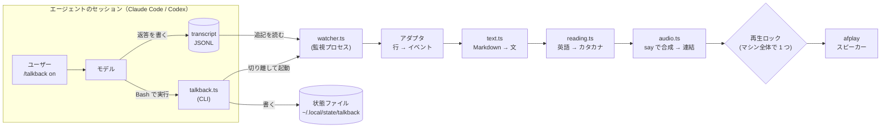
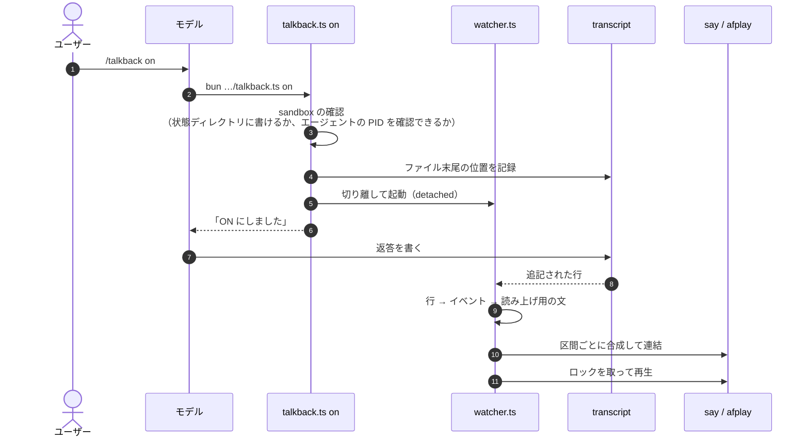
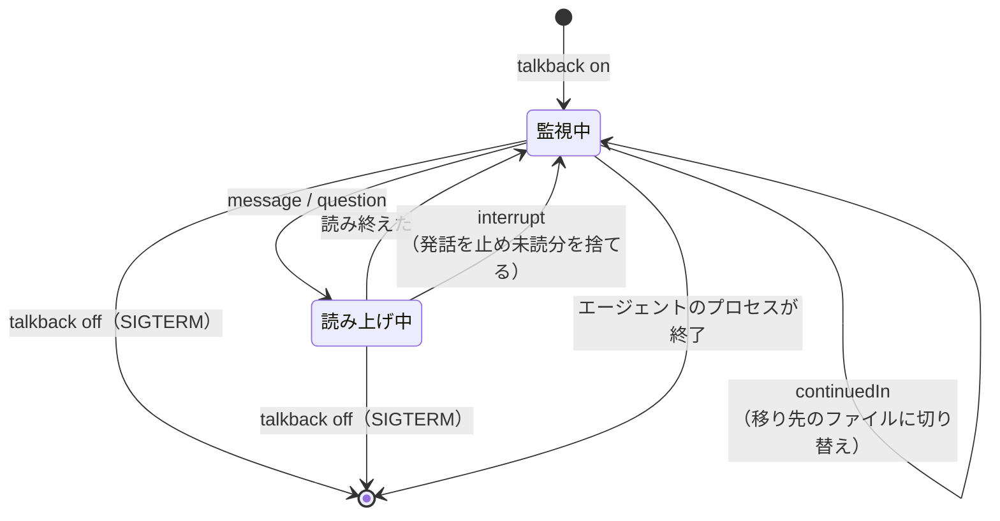
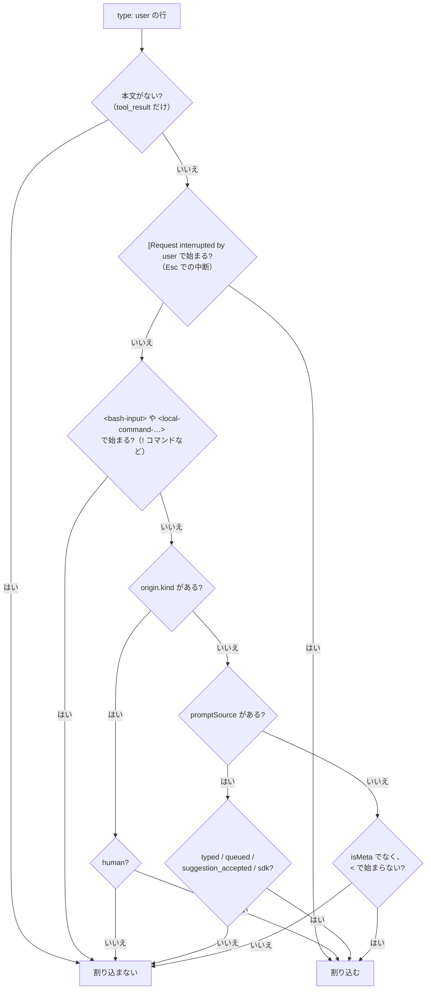
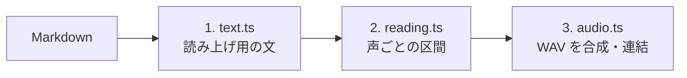
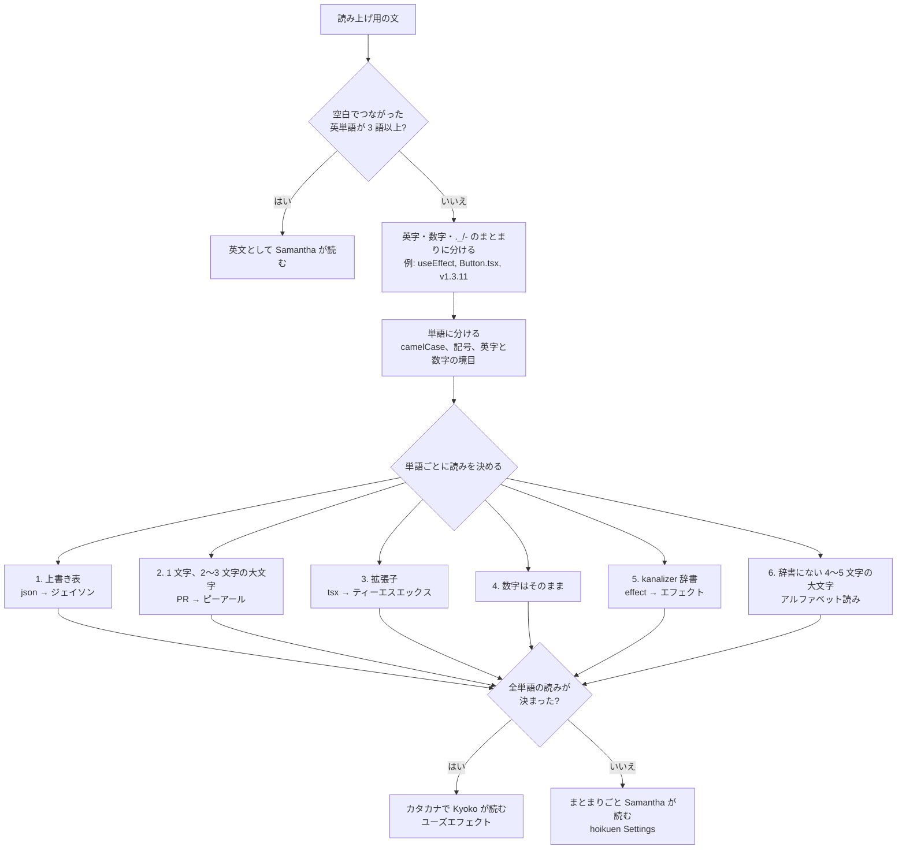
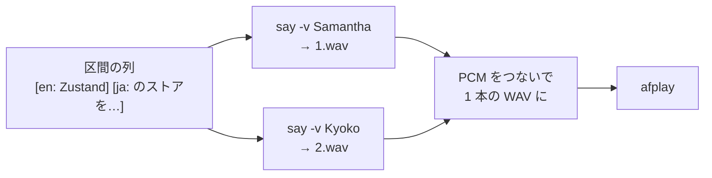
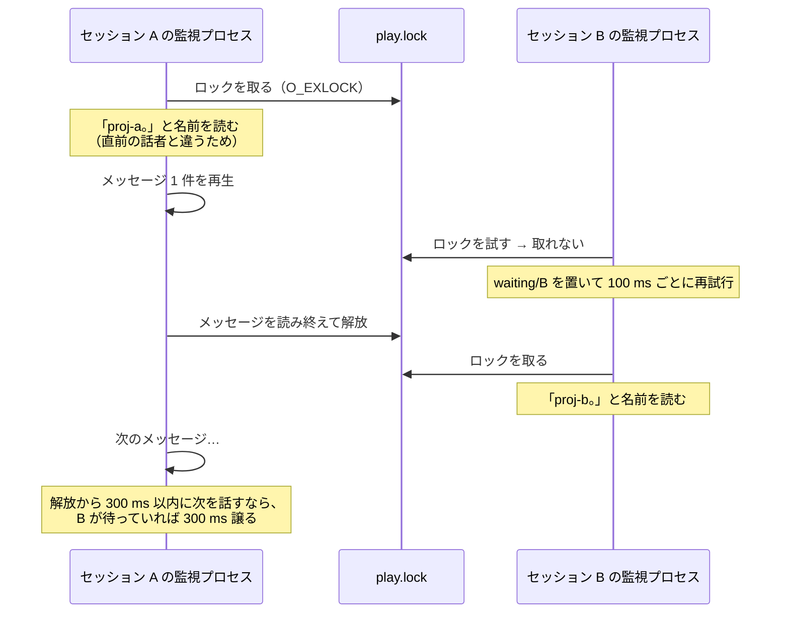
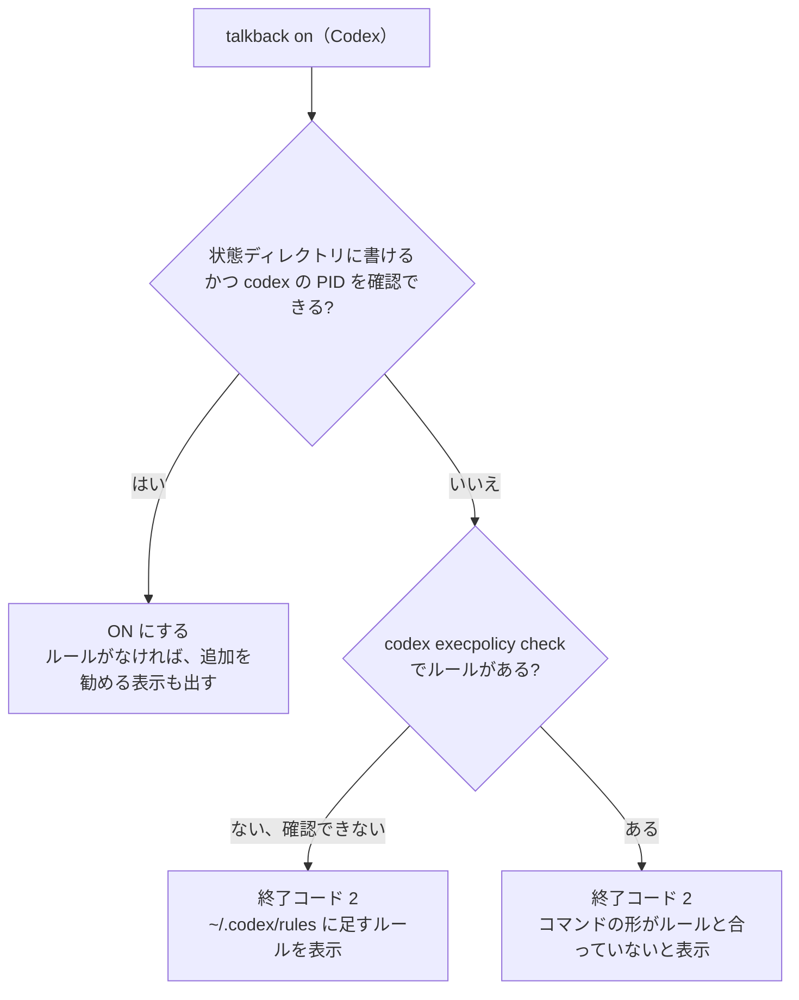

# talkback の仕組み

`talkback` は、エージェントのセッションの transcript（会話の記録ファイル）を監視し、assistant が書いた文を macOS の `say` で読み上げる。hook は使わず、ON にしたセッションごとに監視プロセスを 1 つ動かす。

この文書は、コードを読む前に全体像をつかむためのものである。各規則の具体的な値（正規表現、しきい値、判定の順序）は、コードとテストが正である。この文書には、コードから読み取りにくい「なぜそう判定するか」を書く。設計の判断と、採用しなかった案は [decisions.md](decisions.md) にある。

## 全体像



CLI は ON/OFF を切り替えるだけで、すぐに終わる。読み上げを担当するのは監視プロセスで、エージェントのプロセスが終了するまで動き続ける。

## ファイル構成

```text
skills/talkback/
├── SKILL.md              # モデルに、いつ・どう CLI を実行するかを伝える（英語）
├── README.md             # 使う人向けの説明
├── docs/                 # 保守する人向けの文書（この文書と decisions.md）
├── agents/openai.yaml    # Codex 向けの表示用メタデータ
├── scripts/
│   ├── talkback.ts         # CLI: on | off | status | doctor
│   ├── watcher.ts          # セッションごとの監視プロセス
│   ├── dev/build-dict.ts   # kanalizer-dataset を TSV に変換する（開発者用）
│   └── lib/
│       ├── adapters/       # Claude Code と Codex の transcript をイベントに変換する
│       ├── text.ts         # 1 層目: Markdown → 読み上げ用の文
│       ├── reading.ts      # 2 層目: 英語の読みを決め、声の役割ごとの区間に分ける
│       ├── audio.ts        # 3 層目: 合成、WAV の連結、再生
│       ├── lock.ts         # マシン全体の再生ロック
│       └── agent.ts, proc.ts, state.ts, paths.ts
├── tests/                  # bun test。say と afplay は PATH の先頭に置いた偽物で置き換える
└── assets/katakana/
    ├── overrides.tsv         # 自前の上書き表
    ├── kanalizer.tsv         # kanalizer-dataset を変換したもの
    └── kanalizer.LICENSE     # kanalizer-dataset のライセンス、出典、取り込んだ revision
```

実行時の状態は次の場所に置く。

```text
~/.local/state/talkback/            # 0700
├── sessions/<session-id>.json      # 監視プロセスとエージェントの PID・起動時刻、transcript、cwd
├── play.lock                       # 再生ロック
├── waiting/<session-id>            # ロック待ちの目印
├── last-speaker                    # 最後に話したセッション（名前を読むかの判定）
└── logs/<session-id>.log           # 本文は書かない。1 MB を超えたら空にする

$TMPDIR/talkback-<session-id>-XXXXXX/  # 合成した WAV。再生後と終了時に消す
```

ログに本文を書かないのは、transcript にツールの出力や秘密の値が含まれうるからである。

## スキル（`SKILL.md`）

スキルはモデルに、`bun <skill-dir>/scripts/talkback.ts <on|off|status|doctor>` を 1 回実行し、結果を 1 行で報告するよう指示する。

- Claude Code では、frontmatter の `allowed-tools` で `talkback.ts` の実行を許可する。ON/OFF のたびに許可を求められないようにするためである。
- Codex では、コマンドを `bash -lc` などで包まずに実行させる。実行ルールは、コマンドの形で照合されるからである。
- `agents/openai.yaml` で `allow_implicit_invocation: false` にしている。明示的に頼まれない限り、モデルが読み上げを ON にしないためである。

## ON にしてから読み上げるまで



`on` の手順は次のとおりである。

1. [sandbox の確認](#sandbox) を行う。
2. エージェントの PID を特定する。特定できなければ終了コード 2 で終わる。生存を確認できない監視プロセスは、終了できずに残り続けるからである。
3. 同じセッションの監視プロセスが動いていれば、何もせずに終わる。Claude Code では、同じエージェントのプロセスで別のセッション ID の監視プロセスが動いていれば止める。`/clear` でセッションが切り替わった後に残ったものだからである。Codex では止めない。1 つのアプリのプロセスが、複数のスレッドを同時に扱うことがあるからである。
4. transcript を `<セッション ID>.jsonl` の完全一致で探し（見つからなければ 300 ms 間隔で 10 回まで探し直す）、その時点のファイル末尾の位置を記録する。監視プロセスはこの位置から読むので、履歴は読まない。
5. 監視プロセスを切り離して起動し（`Bun.spawn` の `detached: true`）、状態ファイルを書く。切り離したプロセスは、自分のプロセスグループの先頭になる。300 ms 後に監視プロセスが生きていなければ、終了コード 1 で終わる。
6. cwd は、transcript の先頭の行（セッションを始めた場所）から取って固定する。後の行の cwd は、作業中の `cd` でサブディレクトリに変わるからである。

`off` は、状態ファイルの監視プロセスのプロセスグループに `SIGTERM` を送る。グループごと送るので、合成中の `say` と再生中の `afplay` も止まる。3 秒たっても止まらなければ `SIGKILL` を送る。送る前に、PID と起動時刻が記録と一致し、コマンドラインに `watcher.ts` が含まれることを確かめる。セッション ID は照合しない。resume のあとも、監視プロセスのコマンドラインには起動時のセッション ID が残るからである。

CLI の終了コードは、0 が成功、1 が実行時エラー、2 が前提条件の不足（直し方を出力する）である。

## エージェントと transcript の特定

CLI は、環境変数からエージェントの種類とセッションを判定する。上の行から順に判定する。

| エージェント | 判定 | セッション ID | 生存を確認するプロセス | transcript |
| --- | --- | --- | --- | --- |
| Codex | `CODEX_THREAD_ID` がある | `CODEX_THREAD_ID` | 祖先プロセスのうち最も近い `codex` | `~/.codex/sessions/YYYY/MM/DD/rollout-*-<ID>.jsonl` |
| Claude Code | `CLAUDECODE=1` | `CLAUDE_CODE_SESSION_ID` | `CLAUDE_PID` | `~/.claude/projects/<project-slug>/<ID>.jsonl` |

transcript の探索先は、`CLAUDE_CONFIG_DIR` や `CODEX_HOME` が設定されていれば、それに従う。セッション ID は、ファイル名に使うので、英数字とハイフンだけからなることを確かめる。

Codex を先に判定するのは、Claude Code から起動した Codex（codex プラグイン経由など）には、Claude Code の環境変数も引き継がれるからである。

PID は、常に起動時刻（`ps -o lstart=`）と組にして扱う。終了したプロセスの PID が別のプロセスに再利用されると、PID だけでは生死を取り違えるからである。

## 監視プロセスの一生



- 追記された行は `fs.watch` で追い、250 ms ごとのポーリングで取りこぼしを補う。末尾の行が書きかけなら、改行が届くまで保持する。記録した開始位置が行の途中だったら、次の改行までを読み飛ばす。
- エージェントのプロセスが生きているかを 2 秒ごとに確かめ、いなくなったら終了する。
- 終了するときは、合成と再生の子プロセスを止め、ロック、待ちの目印、一時 WAV、状態ファイルを片付ける。
- 起動時に、プロジェクト名を読む WAV を先に合成しておく。メッセージの 1 つ目のかたまりも、ロックを取る前に合成を始める。ロックを取ってから合成すると、発話が遅れるからである。

### resume でファイルが移ったとき（Claude Code）

Claude Code は、resume や fork でセッション ID を変え、新しいファイルに会話を書き続ける。元のファイルには `type: "continued-in"` の行（`continuedInSessionId` に移り先の ID）が書かれる。

- 移り先のファイルは、`continued-in` の行より数秒遅れて作られる。そのため、現れるまでポーリングで待つ。60 秒待っても現れなければ終了する。
- 移り先のファイルの先頭には、それまでの履歴が新しいセッション ID でコピーされている。そのため、移り先はファイルの末尾から読む。
- 状態ファイルを新しいセッション ID の名前に移す。移り先のセッションで実行した `off` と `status` が、新しい ID で状態ファイルを探すからである。

## transcript の行をイベントに変える（アダプタ）

アダプタは、transcript の 1 行を次の 4 種類のイベントに変換する。本文は、届いた時点ですぐ `message` にする。

| イベント | 意味 | 監視プロセスの動き |
| --- | --- | --- |
| `message` | assistant が書いた文 | 読み上げの列に並べる |
| `question` | ユーザーへの質問 | 「質問です。」（複数なら「質問が N つあります。」）と前置きして質問文を読む。選択肢は読まない |
| `interrupt` | ユーザーの新しい指示、または中断 | 今の発話を止め、未読分を捨てる。ロック待ちもやめる |
| `continuedIn` | transcript が別ファイルに移った | 移り先のファイルに切り替える |

ツールの呼び出しと結果は、どのイベントにもならない。

### Claude Code の行

| 行 | イベント |
| --- | --- |
| `type: "assistant"`、content block が `text` | `message` |
| `type: "assistant"`、content block が `tool_use` で `name: "AskUserQuestion"` | `question`（`input.questions[].question`） |
| `type: "user"`（判定は下の図） | `interrupt` または無視 |
| `type: "attachment"`、`attachment.type: "queued_command"`、`attachment.origin.kind: "human"` | `interrupt`（作業中に入力して待たせているプロンプト） |
| `type: "continued-in"` | `continuedIn` |
| `isSidechain: true` の行 | 無視する（subagent の出力は、今は別ファイルに書かれる） |

`type: "user"` の行には、ユーザーの入力以外も多く含まれる。subagent やタスクの完了通知（`<task-notification>`）、`<system-reminder>`、`!` コマンドの入出力（`<bash-input>`）、ツールの結果などである。これらで割り込むと、バックグラウンドの作業が終わるたびに読み上げが止まる。そのため、次の順に判定する。



- `!` コマンドの行は `origin.kind: "human"` で書かれるが、エージェントへの指示ではない。そのため、タグで除外してから `origin.kind` を見る。
- ユーザーが入力したスラッシュコマンド（`<command-message>` で始まる行）は、新しい指示として割り込む。ただし、`origin.kind` も `promptSource` もない古い形式の transcript では、先頭の `<` で除外されるので割り込まない。
- `origin.kind` と `promptSource` は、新しい形式の transcript にだけある。古い形式では、`isMeta` と先頭の `<` で判定する。

### Codex の行

| 行 | イベント |
| --- | --- |
| `type: "event_msg"`、`payload.type: "agent_message"` | `message` |
| `type: "response_item"`、`payload.type: "function_call"`、`payload.name: "request_user_input"` | `question`（引数の JSON の `questions[].question`） |
| `type: "event_msg"`、`payload.type: "user_message"` で、本文が `<` で始まらない | `interrupt` |
| `type: "event_msg"`、`payload.type: "turn_aborted"` | `interrupt` |

- `agent_message` の `phase` は見ない。デスクトップアプリの一部の版が `phase` を書かないからである。
- `response_item` の `message` には、`agent_message` と同じ文が重複して入るので使わない。
- subagent のスレッドは別の rollout に書かれるので、親のファイルには混ざらない。

アダプタは未知の種類の行を無視する。JSON として解析できない行は、監視プロセスがログに書いて読み飛ばす。形式が変わったときに、監視プロセスが異常終了するのではなく、読み上げが止まるだけで済ませるためである。

## 文を読み上げ用に変える

1 件のメッセージは、3 つの層を順に通る。



1 層目はエンジンに依存しない。2 層目と 3 層目は `say` に合わせて作っている。`say` 以外のエンジンに対応するときの方針は、[decisions.md](decisions.md#音声エンジンの差し替え) にある。

### 1. Markdown → 読み上げ用の文（`text.ts`）

`Bun.markdown.render` のコールバックで、要素ごとに読み方を決める。メッセージは監視プロセスに届く時点で完結しているので、逐次型のパーサーは要らない。

| 入力 | 読み上げ | 理由 |
| --- | --- | --- |
| ` ```ts ` で始まる 12 行のコードブロック | TypeScript のコード 12 行。 | 中身を読み上げても聞き取れない |
| 本文 3 行の表 | 3 行の表。 | 同上 |
| `` `npm test` `` を実行 | npm test を実行 | 日本語の文では、インラインコードが目的語になりやすい。消すと文が欠ける |
| `` `src/components/Button.tsx` `` | Button.tsx | パスの前半は聞いても役に立たない |
| `[PR](https://…)` を見て | PR を見て | URL は聞き取れない |
| `https://e.com/a` を参照 | リンクを参照 | 同上 |
| `[[volm 0]]` | volm 0 | `say` は標準入力の `[[ ]]` も埋め込みコマンドとして解釈し、音量や速度が変わる |
| 絵文字、HTML タグ | （読まない） | Kyoko が絵文字の名前を読み上げてしまう |

- 見出しやリスト項目のように句点のない行には「。」を補う。Kyoko は句点がないと、行と行を続けて読んでしまうからである。
- 絵文字は `[[` の除去より先に消す。`[🎉[` のように、絵文字を挟んだ `[[` を残さないためである。
- パスとみなすのは、`/`、`./`、`../`、`~/` で始まるものか、拡張子の付いた名前で終わるものだけである。`ON/OFF`、`TODO/FIXME`、`2026/10/23` を縮めないためである。
- URL は ASCII の文字だけを URL とみなす。`https://e.com/aを参照` のように、直後に続く日本語を消さないためである。
- ネストしたリストやリスト内のコードブロックでは、ブロックの区切りが行の途中に来る。そのため、行頭ではなく区切りの印で分割する。

### 2. 英語 → カタカナ（`reading.ts`）

Kyoko は英語を聞き取りにくく読むので、英単語をカタカナに直す。



| 入力 | 出力 | 声 |
| --- | --- | --- |
| `useEffect` を直しました | ユーズエフェクト を直しました | Kyoko |
| `Button.tsx` | ボタン ティーエスエックス | Kyoko |
| `python3.12` | パイソン3.12 | Kyoko |
| `v1.3.11` | ブイ1.3.11 | Kyoko |
| `PRs` と `APIs` | ピーアールズ と エーピーアイズ | Kyoko |
| Use the default config で動きます | Use the default config ／ で動きます | Samantha ／ Kyoko |

- 3 語以上の英文をまとめて Samantha に渡すのは、英文の途中で声が何度も入れ替わらないようにするためである。
- まとまりの中に読めない語が 1 つでもあれば、まとまり全体を Samantha に渡す。1 つの識別子の途中で声を切り替えないためである。
- 4〜5 文字の大文字の語を辞書の後に回すのは、`HEAD` や `TODO` を単語として読ませるためである。
- 拡張子とみなすのは、`reading.ts` の拡張子の一覧にある語だけである。`React.memo` の `memo` を、アルファベット読みにしないためである。
- 数字の間の `.` と `-` は区切らない。`3.12` や `2026-10-23` を「3 12」のように読ませないためである。
- 2〜5 文字の大文字に `s` が付いた語（`PRs`）は、複数形の頭字語として読む。上の図では省いている。

辞書は 2 つある。

| ファイル | 中身 |
| --- | --- |
| `overrides.tsv` | kanalizer-dataset にない開発用語（`json`、`readme`、`async` など）と、kanalizer-dataset の誤りの修正（`button` →「ボタン」、`id` →「アイディー」など）。手で保守する |
| `kanalizer.tsv` | VOICEVOX の kanalizer-dataset（約 11.8 万語）を `word<TAB>katakana` に変換したもの。監視プロセスの起動時に `Map` に読み込む |

kanalizer-dataset は、小文字にした頭字語の読みを誤ることがある（`http` →「ハットップ」など）。このような語は `overrides.tsv` で直す。

kanalizer-dataset を更新するときは、新しい `dataset.jsonl` を取得して `bun scripts/dev/build-dict.ts <dataset.jsonl>` を実行し、`kanalizer.LICENSE` の revision と取得日を書き換える。

### 3. 合成と連結（`audio.ts`）



- 区間ごとの合成は並列に行い、できた WAV の PCM データをつないで 1 本にする。全区間を同じ形式（22.05 kHz、16 bit、モノラル）で出力させるので、つなぐだけで済む。声が切り替わるところでも間が空かない。
- WAV のヘッダーは固定長と仮定せず、`data` チャンクを探して中身を取り出す。Apple の WAV には、`FLLR` などの余分なチャンクが入ることがあるからである。
- テキストは `say` の標準入力で渡す。コマンド引数で渡すと、`--dry-run` のように `-` で始まる文がオプションと解釈されるからである。
- 長いメッセージは 3 文か 300 文字ごとに分け、1 つ目を再生している間に 2 つ目を合成する。

## 複数のセッションが ON のとき

発話が重ならないよう、マシン全体で 1 つの再生ロック（`play.lock`）を取り合う。



- ロックはメッセージ 1 件の間ずっと持つ。2 つのセッションの文が交互に混ざらないようにするためである。
- ロックは `open(2)` の `O_EXLOCK | O_NONBLOCK` で取る。ロックを持ったプロセスが異常終了しても、カーネルが解放するからである。
- ロックを解放したセッションは、解放から 300 ms 以内に次のメッセージを話そうとしていて、他のセッションが待っていれば、300 ms 待ってから取り直す。メッセージが続くセッションがロックを取り続けないようにするためである。セッション間の順番は保証しない。
- 話者が前回と変わったときだけ、先にプロジェクト名を読む。ON になっている他のセッションに同じディレクトリ名があれば、親ディレクトリの名前を前に付ける。名前の再生中に割り込まれたら `last-speaker` を書き換えず、次の発話で読み直す。

割り込みが効くのは、ユーザーの入力や中断が transcript に書かれた時点である。キーを押した時点ではない。

## sandbox

`on` と `off` は、最初に sandbox の中で実行されていないかを確かめる。確かめるのは、状態ディレクトリに書き込めるかと、エージェントのプロセスを特定して生存を確認できるかの 2 点である。書き込みだけでは足りない。書き込みを許していても、`ps` や `kill` を拒否する sandbox の構成がありうるからである。

`off` で先に確かめるのは、sandbox の中ではすべてのプロセスが止まっているように見えるからである。確かめずに進むと、動いている監視プロセスの状態ファイルを消してしまう。

### Codex

Codex の `workspace-write` の sandbox では、シェルツールから起動したプロセスに制限が引き継がれる。監視プロセスは、Codex のプロセスを特定することも、生存を確認することもできない。そのため、talkback は Codex の実行ルール（`~/.codex/rules/*.rules` の `prefix_rule`）で sandbox の外で実行させる。



- `decision = "allow"` に一致したコマンドは、承認を求めずに sandbox の外で実行される。
- ルールは、Codex が実行する最上位のコマンドのトークン列と、先頭から完全一致で照合される。パターンにサブコマンドを含めないのは、1 つのルールで `on` から `doctor` まですべてを許可するためである。
- シンボリックリンクでインストールした場合、モデルがリンクのパスと実体のパスのどちらを使うかは決まらない。そのため、両方のパスのルールを出力する。
- ルールがないとき、モデルは 1 回限りの権限昇格（`sandbox_permissions: "require_escalated"`）を求められる。この場合、`on` は成功したうえで、ルールの追加を勧める。

### Claude Code

Claude Code の Bash の sandbox が有効な場合も、同じ確認で検出し、`talkback.ts` を sandbox の対象から外す設定（`sandbox.excludedCommands` など）を案内する。この確認が実際にどう失敗するかは、まだ検証していない。

## 依存している外部の形式と確認方法

talkback は、公開されていない形式にいくつも依存している。どれも、エージェントの更新で変わりうる。

| 依存している内容 | 確認方法 |
| --- | --- |
| Claude Code は Bash に `CLAUDE_CODE_SESSION_ID` と `CLAUDE_PID` を渡し、PID は `claude` プロセスと一致する | デスクトップアプリ（Code タブ）と CLI の `claude -p`。Claude Code 2.1.309 |
| 切り離したプロセスは、Claude Code の Bash ツールの終了後も残る | デスクトップアプリ |
| Claude Code の transcript は content block ごとに 1 行書かれる | 手元の transcript を確認 |
| Claude Code の `type: "user"` の行には、ユーザーの入力以外（`<task-notification>`、`<command-name>`、`<system-reminder>`、`<bash-input>` など）も含まれる。`!` コマンドの行は `origin.kind: "human"` で書かれる | 手元の transcript の構造を集計。`!code .` で読み上げが切れたことも観測した |
| `AskUserQuestion` は `tool_use` の行として書かれ、質問文は `input.questions[].question` に入る | 手元の transcript を確認 |
| resume すると、移り先のファイルは `continued-in` の行の 3〜4 秒後に作られ、先頭に履歴が新しいセッション ID でコピーされる | 手元の transcript 3 件を確認 |
| Claude Code のデスクトップアプリは、ツールを呼ぶ前に書いた本文を transcript に残さないことが多い（111 件中 20 件だけ残っていた） | この開発のセッションの transcript を集計 |
| Codex のデスクトップアプリ（`Codex Desktop 0.128.0-alpha.1`）は、`agent_message` に `phase` を書かない | 手元の rollout を確認 |
| Codex の `request_user_input` は `response_item` の `function_call` として書かれ、質問文は引数の JSON の `questions[].question` に入る | 手元の rollout を確認 |
| `CODEX_THREAD_ID` は rollout のスレッド ID と一致する | Codex 0.137.0 のソースのみ |
| Codex の sandbox では、`ps`、sandbox 外のプロセスへの `kill -0`、`~/.local/state` への書き込みが拒否される。`$TMPDIR` への書き込み、transcript の読み取り、`say` はできる | `codex sandbox -c sandbox_mode="workspace-write"`（モデルは使っていない） |
| `decision = "allow"` の実行ルールに一致したコマンドは、sandbox の外で実行される | codex-cli 0.137.0 のソースと公式ドキュメント |
| `say` は、標準入力で渡した `[[slnc 2000]]` も埋め込みコマンドとして解釈する | macOS の `say` |
| Bun の `fs.openSync` に `O_EXLOCK \| O_NONBLOCK` を渡すとロックとして働き、保持者を `SIGKILL` で終了させるとロックは解放される | Bun 1.3.11 |

`doctor` は、環境変数からセッションを検出できるか、エージェントのプロセスを確認できるか、transcript の最新の行を解析できるかを確かめる。形式が変わったときに、最初に気づける場所である。
